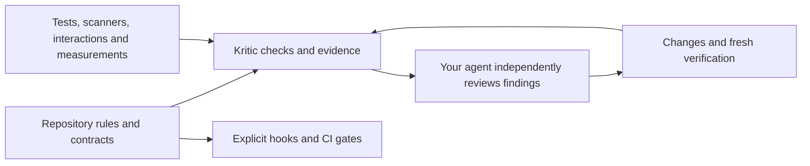

# Kritic

**Governance, verification and review for AI-assisted software work. No GPU required.**

Kritic is an experimental, repository-owned governance system for coding agents. It helps you turn
project expectations into explicit contracts, collect evidence about the work, enforce selected
repository policies, and notice when tests, assumptions or maintenance needs have drifted.
It covers code, tests, UI/UX, debugging, dependencies and resources through a shared review workflow.

Your existing agent does the reasoning. Kritic supplies a **skill, a Rust MCP server, standalone
CLI checks, and repository configuration**. Use it with Codex, local Work, Cursor, Claude Code,
Hermes or another compatible client. The default workflow needs no local model, separate LLM API
account or dedicated GPU. Optional local/cloud reviewers can provide additional judgments.

> **Test release: test the system, not just your project.** Agents must independently validate
> critic findings and evidence, reproduce Kritic defects, fix them with regression coverage and
> contribute a PR. A critic's approval never grants permission to ship or proves the work is complete.

[Get started](#quickstart-install-the-minimum-then-choose-extras) ·
[Choose capabilities](#choose-your-capabilities) · [Hardware](#what-your-hardware-can-run) ·
[Client setup](docs/clients.md) · [Test release](https://github.com/TmRxJD/kritic/releases/tag/v0.5.0-test.6)

## What Kritic governs

| Concern | What it checks or supports | Boundary of the claim |
|---|---|---|
| **Requirements and acceptance** | Work contracts, current input/evidence hashes, declared assertions and enforcement wiring. | Uncovered prose and unrun checks stay unverified. A weak assertion cannot establish the whole requirement. |
| **Repository discipline** | Broad/focused/atomic commit budgets, staged-tree scope plans, file size, naming, layers, imports and organization rules. Explicit local hooks can reject noncompliant commits. | Size and pattern compliance do not prove semantic cohesion, modularity or good comments. Hooks can be bypassed. |
| **Tests and canonical sources** | One graph of canonical owners, test dependencies, reviewed hashes and generated JSON fixtures. Staleness checks flag drift; invariant checks inspect declared boundaries, guards and negative-test bindings. | Consistent hashes or matching guard text do not prove tests are correct, execute, or cover every important boundary. |
| **Implementation and behavior** | Project validators, security scanners, linters, browser interactions, accessibility/workflow rules, Windows desktop tests and resource/process measurements. | Evidence covers the checks and states actually exercised. Missing dependencies and unobserved effects remain gaps. |
| **Problem framing and product quality** | Debugging-case consistency, competing explanations and causal evidence; optional screenshot/novice review against explicit visual and workflow goals. | A consistent frame is not a proven root cause. Functional success does not establish professional or AAA quality. |
| **Maintenance and continuity** | Dependency inventory, opt-in registry lookups, estimated urgency/upgrade effort, private review history and comparison of explicit snapshots. | No automatic dependency upgrades, compatibility guarantee, cached acceptance or demonstrated cross-task learning. |
| **Command output** | Portable `kev run` / `kev show`, raw stdout/stderr archives, bounded deterministic excerpts and optional local relevance ranking. No GPU or MCP required. | Finite noninteractive commands only; excerpts can clip diagnostics. Model rankings never establish success. [Guide](docs/cli-filter.md). |
| **Agent context and project extensions** | Compact MCP discovery, optional context helpers, a separately enabled Hermes archive/recall engine, repository plugins and a Beat Saber evaluator. | No autonomous agent orchestration, implicit context takeover or general proof of domain quality. |

Governance here means **explicit expectations, scoped evidence, review and deliberate enforcement**.
It is not a promise of autonomous correctness. The agent chooses and validates the next action;
repository owners choose which policies become hooks or CI gates.

## How it fits your workflow



1. **Define the work.** Use real acceptance criteria and authoritative repository sources.
   [Work contracts](docs/contracts.md) and [repository policies](docs/repository-policy.md) make
   the selected requirements explicit. Unknown requirements stay visible.
2. **Collect evidence.** Run relevant validators and critics. The skill guides setup and recovery;
   agents should repair ordinary missing configuration instead of forwarding bare OS errors.
3. **Challenge the conclusion.** Read the source, reproduce reported defects and distinguish
   a stale expectation from a regression. When debugging stalls, use [framing review](docs/framing.md)
   to examine the evidence and alternatives before another patch.
4. **Enforce deliberately.** Configure scoped commit hooks and CI checks where appropriate.
   [Test/invariant contracts](docs/staleness.md) share one canonical graph with work-contract checks.
5. **Recheck after change.** Fresh validators establish current results. Optional
   [history](docs/memory-adapter.md) helps compare reviews but never substitutes for a new run.

## Quickstart: install the minimum, then choose extras

**Windows x86-64 is the full tested distribution.** The Apple Silicon archive contains the CLI filter only; the Mac MCP server requires a source build. Start without models and add only relevant tools.

1. Download the Windows ZIP from [v0.5.0-test.6](https://github.com/TmRxJD/kritic/releases/tag/v0.5.0-test.6),
   verify it against the release's `SHA256SUMS`, and extract it into a persistent location.
   The ZIP includes `kritic.exe`, `kev.exe`, `kev-filter.exe`, the skill, examples, documentation and optional desktop harness.
   Install the [Microsoft Visual C++ x64 runtime](https://learn.microsoft.com/en-us/cpp/windows/latest-supported-vc-redist?view=msvc-170)
   if absent. The minimum setup needs no Rust, Python, Node, Ollama, model or separate API key.
2. In PowerShell, open the extracted `kritic` folder and use the fresh-install commands below.
   **For an existing installation, back up and merge settings; do not overwrite its configuration.**
3. Connect **both the MCP server and the skill** using the supplied
   [Codex/local Work, Cursor, Claude Code or Hermes instructions](docs/clients.md).
   Installing one does not install the other. Restart the MCP connection after changing its
   executable or global configuration.
4. Ask your agent to call `status(start=false, base_dir=<actual repository>)`, follow the
   returned setup guidance, then review a small real change with `artifact_validate(use_model=false)`
   and a meaningful project validator. Status alone is not a completed review.

```powershell
$env:KRITIC_HOME = (Resolve-Path .).Path
# Fresh install only. Preserve an existing kritic.toml instead of replacing it.
if (Test-Path .\kritic.toml) { throw "Existing config: preserve it and merge selected settings." }
Copy-Item .\examples\profiles\minimal.toml .\kritic.toml
.\bin\kritic.exe setup --yes --backend off --no-vision --no-harness --no-scanners --no-register
.\bin\kritic.exe doctor
```

The minimal profile exposes artifact/work-contract checks, native resource/hygiene checks and
utilities. Other capability groups are deliberately hidden. Installing a dependency does not
expose its tools; enabling a capability does not install its dependencies.

If a critic cannot collect evidence, use [agent setup and recovery](docs/agent-setup.md).
`doctor --base-dir <repo> --json` and project-scoped status explain what to configure.
Missing project contracts should be derived from the repository's actual rules, not copied as
all-passing templates. Disabled irrelevant tools are expected.

## Filter noisy command output

```sh
kev run --goal "Find test failures and their causes" -- cargo test
kev show /path/to/runs/run-ID --stream stderr --from 1 --lines 30
# Optional: an already configured Mac Kev-0.8B / MLX endpoint.
kev run --kev --kev-url http://127.0.0.1:8009/v1/systemone --kev-model kev-latest -- cargo test
```

Use `bin/kev.exe` on Windows or `bin/kev` from the Apple Silicon CLI archive;
`kev-filter` is an equivalent alias. No model, GPU or MCP setup is required for
filtering. Rust preserves raw output and child exit status; optional Kev ranks
ordinary stdout rather than generating summaries or deciding success. Excerpts
are bounded and may omit useful text: retrieve the raw evidence before drawing
conclusions. Private logs have no automatic redaction/retention. [Full setup,
limits, exit codes and source-build instructions](docs/cli-filter.md).

## Choose your capabilities

Set the relevant keys in `[capabilities]` in `$KRITIC_HOME/kritic.toml`, then reconnect MCP.
For every deterministic row, leave `[review].backend` and `[vision].backend` set to `"off"`.
[All configuration keys and environment overrides](examples/kritic.toml).

| Add | Toggle / prerequisite | Result and setup |
|---|---|---|
| **Commit and architecture policy** | `repository=true`; Git and `.kritic/repository.toml` | `repository_critic`, CLI scope plans and an explicitly installed hook. Choose `broad`, `focused` (default) or `atomic`. [Policy setup](docs/repository-policy.md). |
| **Test currency and canonical sources** | `staleness=true`; `.kritic/test-contracts.toml` | `staleness_critic`; CLI `kritic staleness check`. `sync` previews fixture changes; only `sync --write` writes declared JSON projections. Review pins and assertions are never auto-blessed. [Guide](docs/staleness.md). |
| **Boundary invariants** | `invariants=true`; the same test-contract manifest | `invariant_critic`; CLI `kritic staleness invariants`. Checks required guards, release/debug mismatches, failure policies and mapped negative cases. Review whether the conditions are sensible and actually enforced. [Guide](docs/staleness.md#invariants-at-key-boundaries). |
| **Debugging framing** | `framing=true`; `.kritic/debug-case.json` and real evidence | `framing_critic`; CLI `kritic framing --schema`. This opt-in critic alone may be consulted at a stalled-debugging checkpoint. No experiments or commands run automatically. [Guide](docs/framing.md). |
| **Browser and UX checks** | `web=true`, `ux=true`; Chrome/Edge/Chromium and a useful target/workflow | `ui_test`, deterministic `ux_critic(novice="off")`. Native CDP needs no Node/Playwright. Provision enabled harness groups with setup; see below. [Tools](docs/tools.md). |
| **Security scanning** | `security=true`; gitleaks, OSV, Semgrep/Bandit and relevant scanners | `security_critic`. Setup provisions scanner tools; uv is needed for Python scanner installation. Missing scanners remain gaps; cargo-audit is an optional cross-check. [Setup](docs/agent-setup.md). |
| **Code quality** | `quality=true`; the project's linters/typechecker and dependencies | `code_quality_critic`, metrics and declared organization rules. Kritic does not install the project's toolchain. [Tools](docs/tools.md). |
| **Windows desktop / Unity** | `desktop=true`, optionally `ux=true`; Python 3.11+, uv, pywinauto, interactive desktop; matching Unity editor if used | Desktop interactions, workflow evidence and Unity tests. The app under test may need its own GPU. [Desktop](docs/tools.md), [Unity](docs/unity.md). |
| **Technical debt** | `debt=true`; real manifests/lockfiles | Offline inventory and maintenance review. Separately opt in to `online=true` for public registry evidence. Urgency and migration effort are estimates, not an upgrade promise. [Guide](docs/technical-debt.md). |
| **Review history** | `history=true`; explicit reports, inputs and private storage | Record/list/compare snapshots and export a separate low-trust jcode-format file. No automatic indexing or live jcode integration. [Guide](docs/memory-adapter.md). |
| **Project plugins / maps** | `plugins=true` / `domain_maps=true`; relevant project evaluator and dependencies | Explicit repository checks or Beat Saber structural/heuristic evaluation. [Plugins](docs/plugins.md), [maps](docs/tools.md). |
| **Additional model opinions** | Explicit text/vision backend and compatible provider/model | Text criticism, screenshot review, model novice or context helpers. Separate installation/credentials are optional. [Reviewers](#optional-cloud-or-local-review). |

For fresh **deterministic** optional setup, include `--yes --backend off --no-vision --no-register`.
Use `--no-scanners` when provisioning harness groups, or `--no-harness` when provisioning scanners.
`--no-harness` skips browser and desktop provisioning. Inspect existing settings and `setup --help`
first; those backend flags must not replace an existing model-enabled configuration unintentionally.
Setup may download dependencies. No new model or API account is required for the skill itself.

Environment overrides take precedence over the file, including `KRITIC_CONFIG` and capability/
backend variables. Verify effective settings in status. `doctor --online` explicitly calls a reviewer;
ordinary setup/status does not establish inference quality. Source builds and other platforms use
[the source installation path](docs/getting-started.md#install-from-source-and-configure).

## What your hardware can run

Capabilities are chosen explicitly; GPU detection does not turn them on. **16 GB system RAM is a
practical recommendation for an IDE/browser and ordinary projects, not a measured minimum.**
Budget the project's builds, browsers and scanners separately.

| Machine / reviewer | What you can use | Limits |
|---|---|---|
| **CPU, no dedicated GPU, no extra API key** | Governance/contracts, repository/test/invariant/framing checks, history/debt, and other deterministic tools after enabling relevant groups and installing dependencies. Your current agent interprets the evidence. | No separate Kritic model scores or image-model opinions with backends off. No blanket offline guarantee: setup, scanners and browsers may access networks. |
| **CPU + direct cloud API** | Deterministic tools plus optional text review; vision/novice with a compatible image-capable API and explicit vision configuration. | Separate API access is required; selected review inputs go to that provider. Assistant subscriptions and host OAuth tokens are not reused. |
| **8 GB GPU** | Deterministic tools and a local Kev Q8 testing target: about 5 GB recorded usage, with roughly 1.5–2 GB reserved for display/system/apps plus slack. | Available VRAM varies. Vision on 8 GB is tight and unverified. Mixed-Q4 Kev is about 4.21 GB on disk, not a 2 GB model. |
| **12 GB+ GPU** | Recommended sequential local Kev/vision testing, alongside deterministic tools. | No promise of concurrent fit or accurate judgments; unrelated applications still use VRAM. |
| **CPU-only local Kev** | Optional slower text review with `kev.cpu_only=true` and a CPU service. | Model RAM/runtime overhead are additional; no measured minimum RAM/latency or CPU-vision guarantee. |

Desktop UI Automation requires Windows and an interactive desktop. Local Work/Codex/Cursor can
use a local installation; a remote/cloud worker needs its own installation and accessible tools.
Kritic ships stdio, not a hosted HTTP MCP service. Linux/macOS core/browser paths need field
validation; this release provides no prebuilt packages for those platforms.

## Optional cloud or local review

You can use the model your coding agent already has to interpret deterministic evidence without
configuring a second model inside Kritic. Direct Kritic reviewers are a separate, optional choice.
Cloud transports support OpenAI, OpenAI-compatible chat endpoints, Anthropic, Gemini and JEV;
choose an exact model ID and credential environment variable. Test your provider's protocol support.

```toml
[review]
backend = "cloud"          # default: off
[cloud]
provider = "openai-compatible"
url = "https://openrouter.ai/api/v1/chat/completions"
model = "your-provider/model-id"
key_env = "OPENROUTER_API_KEY"
max_output_tokens = 4096
```

Cloud judgments are advisory; self-reported confidence does not inherit local calibration.
Screenshots go to a cloud reviewer only when cloud vision is explicitly enabled.
[Cloud setup](docs/cloud.md) · [Local model installation](docs/getting-started.md#optional-local-models).
Model context helpers need `context=true` plus a text backend. Hermes archive/recall is a separate
opt-in; absolute budget caps preserve the real model context length and account for supplied
whole-request overhead rather than treating message-only savings as the whole budget.

## Why Kritic: Kev + critic

**Kritic = Kev + critic.** Kev is the optional local typed-decision engine; the critic is the
review discipline. The governance workflow also works without Kev or any other Kritic model.

A **classifier** assigns inputs to categories, such as issue type, relevance or evidence sufficiency.
Kev uses a language model for bounded, structured decisions rather than generating the implementation.
Typed output alone does not prove classifier training, calibration or correctness. This division
fits the task: real tools collect evidence, optional models help prioritize ambiguous findings,
and your agent independently evaluates the claim. Models can flag correct code or miss subtle bugs.

**Why Rust?** Kritic owns process/browser/file lifetimes and coordinates optional model resources.
Rust's types and ownership make those boundaries explicit; the compiled core needs no Python/Node
runtime or garbage collector. Optional tools retain their own dependencies. Rust supports the
orchestrator's implementation; it does not sandbox commands or make reviewer judgments correct.
[Architecture](docs/architecture.md).

## Evidence from real use

- **GPU-free validation:** Towerium's [public record](https://github.com/TmRxJD/towerium/blob/778febf06ef81a606829997fea8be59a2b52cbe2/VALIDATION.md)
  records controller tests with Kev off. A focused independent/Kritic rerun on 2026-10-10 recorded
  **78 passed, no failures/skips**. This establishes those executed assertions, not whole-game quality.
- **Correcting a governance false positive:** Tracker's intentional JavaScript NUL separator was
  initially rejected as binary. Independent syntax validation passed; Kritic now distinguishes
  valid UTF-8 source warnings from actual coverage failures. [Audit and limits](docs/repository-policy.md#first-tracker-audit).
- **Contract and invariant drift:** Kritic's own example uses independent control-ID vectors,
  derived fixtures and two explicitly mapped test files. The validated change-and-sync smoke
  retained `authority_changed` after fixture regeneration. Three declared invariant bindings
  were checked; this is not a full-repository semantic audit. [Workflow](docs/staleness.md).
- **Project-specific checking:** Beat Agent's real `map-score` plugin rejected a synthetic
  overlapping-note map. This verifies that detector, not human mapping quality or general musicality.
- **Observability corrections:** focus-only/scroll-only browser effects were independently
  reproduced and corrected in native/legacy testers. Missing scanner coverage, stale input hashes,
  and empty/optional-only contracts remain gaps rather than fabricated perfect scores.

[Reproducers, provenance and limitations](docs/field-evidence.md) separate historical measurements
from fresh verification. Report outcomes with the input scope and actual execution evidence.

## Known limitations and experiments

- Canvas/audio/app-state effects can remain unobserved; [issue #1](https://github.com/TmRxJD/kritic/issues/1)
  tracks canvas observation. Unobserved effects produce uncertainty, not a fabricated broken-control claim.
- The Windows desktop harness has shown intermittent empty-output fixture failures; focused reruns
  passed, but a rerun does not erase the failed full-suite observation. Record reproducibility and logs.
- Visual judgments are uncalibrated: `approval=null`. Professional/showcase rubrics and reference
  screenshots support review, not AAA certification. [Visual guidance](docs/visual-quality.md).
- Source/guard hashes and regex bindings cannot prove semantics, reachability or complete coverage.
  Explicit work-contract verification is scoped; CI wiring text is not proof CI ran or branch protection exists.
- History is not live jcode memory integration or cached approval. The optional CPU semantic-map
  experiment met no declared retrieval-quality gate and remains disabled by default.
  [Measurements](docs/semantic-map.md) · [History/export limits](docs/memory-adapter.md).
- Local GPU/provider/OS combinations need field validation. Treat reference-token reductions as
  measurements of MCP discovery, not observed billing savings. [Schema budget](docs/schema-budget.md).

## Review a work contract

Derive `.kritic/contract.toml` from actual repository requirements; use
[the example](examples/contract.toml) for syntax, never as an unchanged passing template.

```sh
kritic contract --base-dir .
# Only after reviewing the declared shell commands:
kritic contract --base-dir . --run-commands
```

Without `--run-commands`, project commands remain unrun/unverified. Contract exit codes are 0 for
verified declared required checks, 1 for violations and 2 for unverified results. Add real behavioral
validators alongside static `test_freshness`/`invariants` checks. [Format and enforcement](docs/contracts.md).
External commands run with your privileges; Kritic is not a command sandbox.

## Testing and contributing

Read the [tester guide](docs/testing-release.md), [contributing guide](CONTRIBUTING.md) and
[security policy](SECURITY.md). The skill header makes independent validation and contributing
reproducible Kritic fixes part of this test release's purpose. Do not weaken tests to obtain green.

```sh
cargo fmt --all -- --check
cargo clippy --all-targets -- -D warnings
cargo test --all-targets
# Hermes tests require the matching real Hermes ABC and this binary's absolute path.
python -m pip install pytest==9.1.1 PyYAML==6.0.3 ruamel.yaml==0.18.16
python -m pytest integrations/hermes/tests
python scripts/test_calibration_policy.py
```

Live models/APIs are opt-in. Offline mocks do not verify every provider/model combination.
Record false positives, false negatives, setup friction and useful findings. Keep private code,
credentials and reports out of public issues. [Agent setup](docs/agent-setup.md).

## Documentation

[Getting started](docs/getting-started.md) · [Configuration](docs/configuration.md) ·
[Client setup](docs/clients.md) · [All tools](docs/tools.md) ·
[Contracts](docs/contracts.md) · [Repository policy](docs/repository-policy.md) ·
[Test/invariant contracts](docs/staleness.md) · [Debugging framing](docs/framing.md) ·
[Technical debt](docs/technical-debt.md) · [Review history](docs/memory-adapter.md) ·
[Architecture](docs/architecture.md) · [Security audit](docs/security-audit.md)

Apache-2.0. Optional models, runtimes, scanners and other dependencies retain their own licenses.

Apple Silicon can opt into [native Kev-0.8B MLX testing](docs/mac-mlx.md), without laya.
The pinned M1 profile uses bounded short requests; all MLX probabilities remain advisory.
A separate 4B configuration template requires fresh quality checks and a larger Mac.
